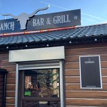
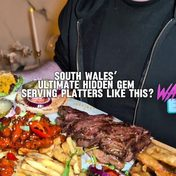
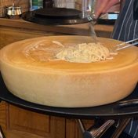
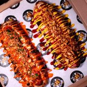
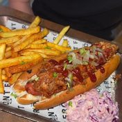

# Trend Discovery Brief — Restaurants, pubs, cafes, pop-ups & markets, Neath Port Talbot

**Pulled:** 3 November 2026 · **Source:** ScrapeCreators API · **Times:** UK local (Europe/London)
**Area:** Neath, Port Talbot, Pontardawe, Aberavon, Briton Ferry, Skewen, Glynneath, Margam, Baglan,
Resolven, Cwmavon, Sandfields, Cimla, Tonna, Ystalyfera, Bryncoch, Crynant, Seven Sisters, Melin

This is the food-and-drink cut. It is a different pull from `trend-brief-2026-11-03.md`, which covered
events, places and activities across the whole county.

## What was actually searched

**717 API calls. 2,753 posts kept after relevance filtering, 2,175 of them food-and-drink.**

| Platform | Posts kept | What it gave |
|---|---|---|
| Facebook | 1,466 | **The listings layer.** No keyword search exists, so 19 groups and 104 venue pages were found via Google and read directly. |
| TikTok | 688 | **The opinion layer.** Where venues are reviewed and where the local canon is argued out in comments. |
| YouTube | 266 | Mostly archive and town-tour content. Weak for food. |
| Google | 226 | Used as a discovery index for Facebook pages and groups, not as a content source. |
| Instagram | 55 | Reels search works, but NPT food yield is thin. |
| Reddit | 30 | Small but high-quality: r/fryup is the best price-per-breakfast dataset in the pull. |
| Threads | 22 | Almost nothing food-related. |

**Five of the ten platforms you asked for do not exist on ScrapeCreators.** `/v1/bluesky/search`,
`/v1/mastodon/search`, `/v1/snapchat/search`, `/v1/discord/search` and `/v1/twitter/search`
(and `/v1/x/search`) all return **HTTP 404** — the provider does not serve those networks, so there is
no Bluesky, Mastodon, Snapchat, Discord or X data here. That is a provider gap, not an absence of local
activity. Facebook has no keyword-search endpoint either; its page and group feeds do work, which is
what made the listings layer possible.

### The listings rule, as applied

A post counted as a **listing** when it named a date. It became a **row** when one venue-night carried a
usable detail — a time, a price, or what is actually on. That produced **239 rows**, of which **34 are
dated today or later**, plus **10 recurring weekly fixtures**. Rows are in
`data/npt-food-social.json`.

Two honesty flags travel with every row. `date_inferred` means the post said "this Saturday" and the
weekday was resolved against the post's own publish date. `needs_check` means the evidence is a Google
snippet rather than the venue's own post. Neither is a guess about the event; both mark how the date was
established.

---

## 1. Main themes

**1. The Chinese takeaway canon is the single most generous conversation in the area, and it lives entirely in comments.**
One mid-sized TikTok asking where to go in Neath produced a complete ranked local directory in its 257
comments — real names, real streets, no website involved anywhere: *"Chopsticks in Neath! Got to be the
best"* (41 likes), *"Tonna Chinese is the best by far I tried all the way from glynneath to neath and
Skewen. it's the best salt and pepper chips ever"*, *"Maxim and new dragon were the best of the best in
neath. But since they've both gone it's shun da in pencaerau/melin that's the best Chinese in neath by
far"*, plus Jade Garden and China Kitchen (Port Talbot), Lucky Star (Caewern), Fortune House and Wok 2
Yip (Skewen), New Garden (Briton Ferry), Lees Garden (Glynneath), Seventh Heaven (Windsor Road) and
Golden Dragon (Port Talbot). None of this is on a website. It is the clearest case in the pull for
treating comments as a data source, not decoration.

**2. Price is the headline metric for breakfast, not quality.**
The fry-up economy is the most quantified thing in the data because r/fryup posts the price in the
title. The Pop In Cafe, Port Talbot at **£5.80** drew 867 upvotes and near-unanimous approval — *"There
we go finally the price of what a fry up should be"*; the Dillwyn Arms, Pontardawe at **£6** (*"Small
but great value that"*, *"£6? Looks grand to me"*); The Hideout Cafe, Port Talbot at **£8.95**. The
emotional centre is Mandy's breakfast rolls in Port Talbot: *"Port talbot is nothing without Mandy's.
Its culture of the place"*, *"I've been going there for 30 years. If you're hungry get a mega"*. A
dashboard that shows the price of a cooked breakfast would be using this data exactly as locals do.

**3. The Sunday roast is the competitive battleground.**
More venues contest it than any other category, and it is the most reliable recurring fixture:
Le Bistro at The Crown, Skewen (carvery every Sunday until 3pm), Blanco's (every Sunday from 12pm),
The Ranch at Resolven (beef at £13.95 — the single highest-reach food post in the pull at 401k views),
The Mine at Neath (*"I think about the mine roast dinners every week absolutely love them"*), plus
The Rolling Mill at Cwmavon, Sand Rabbit and T Bones at Cimla all named by commenters as the real
answer. The one consistent criticism is gravy volume.

**4. Resolven Market is the most-talked-about single place in the whole food-and-drink pull.**
39 independent mentions, well clear of anything else, and it draws people in from outside the county.
It is **Saturdays only, from 6am**. The repeat viral coverage spans years and creators (217k views in
2025, 94k in 2026). Note the counter-current, which is nostalgia rather than complaint: *"the old rheola
was million times better"*, *"Rheola, I remember it in the old location getting up at 4am to sell in
their car boot sale"*.

**5. The forward calendar right now is almost entirely Christmas bookings.**
Of 34 forward-dated rows, the clear majority are festive menus, Santa suppers and party bookings
already on sale — Afan Tavern, The Old White Horse at Pontneathvaughan, The Brit at Cwmavon (Christmas
choir evening, 7pm), The Loft, The Mine (drag bottomless brunch), The Ranch (supper with Santa, 14–16
December), Blanco's Christmas special. If this dashboard goes live now, it is a Christmas-booking board
whether you intend that or not.

**6. The street-food and pop-up layer is small, real, and the hardest to find anywhere else.**
Food at The Shed is the standout: a literal shed in **Plumbwise Car Park, Skewen**, with a second
residency at The Other Place in Pontardawe (87 Commercial Road) *"from 2pm till late"*. Also
ZakInTheBox (Neath), and Baked.ByJones who trade at farmers markets rather than a fixed site
(*"Catch us at Craig Y Nos Country Park Farmers Market 11–3pm"*). These publish nowhere but Facebook
and TikTok, which is precisely the gap you asked about.

**7. Two anchor annual food events, both at fixed sites.**
**Neath Food and Drink Festival** — Neath town centre, 2–3 October 2026, 10:00–17:30, bilingual
promotion, organised with 4theRegion and the NPT Food Partnership. **Big Food Festival** at Gnoll
Country Park — late June (26–28 June in 2026), 11:00–21:30, **free but ticketed through Skiddle**, and
reviewed warmly against rivals: *"I much preferred this food festival in Neath to the Pembrey one"*.
A December edition at the Gnoll was trailed in an October 2025 post; nothing in this pull confirms one
for December 2026, so treat it as unconfirmed.

**8. A small TikTok reviewer economy is doing the area's menu publishing.**
@ashleyxalana is the most prolific by a distance (The Mine, Bella Ciao, The Front, Base, Portablo Coffi,
Grand Sultan, Casa Pizza), with @fearnstar, @roseneatsfood, @sandrofordcomedy, @janefoodbible,
@wayneseats and @kellie_content behind. For venues with no website, these creators are the de facto
menu of record — and one of them is explicitly funded: the Casa Pizza review is tagged
*"Supporting Our Town Centres… funded by the UK Government through the UK Shared Prosperity Fund"*.
Worth knowing before treating reviewer enthusiasm as organic.

**9. Locals do not know their own area, and say so constantly.**
The most repeated sentiment across comment threads is surprise: *"never heard of this place"*,
*"well i live in Port talbot and didn't even no that was there"*, *"omg didnt even know this was there.
im just down the road too"*, *"I keep forgetting The Loft is there"*. Alongside it, the most repeated
*question* is pure logistics — *"what day is it"*, *"is it still open? what days?"*, *"do you have the
postcode for it"*, *"Where in port talbot plz"*. That is the dashboard's job description.

**10. Closure rumour is a live anxiety, and venues now post to deny it.**
Within two weeks in October 2026 both the Dillwyn Arms (*"we've heard a few rumours going around the
village… we're definitely NOT closing down"* — it was a water leak) and Glynneath Bakery
(*"Just to clarify the rumours… IS NOT closing down"*) posted denials. Against that, Warners Bar on
Station Road genuinely did close for good on 18 March 2026 after the premises were sold. A dashboard
showing a closed venue as open would land in the middle of a sensitive local pattern, so the datasource
carries a `closed` list and excludes those venues from live rows.

---

## 2. Best-liked places

Ranked by **independent** mentions — a venue's own posts about itself are excluded, so this measures
being talked about rather than posting a lot.

| Place | Town | Kind | Independent mentions | Why people rate it |
|---|---|---|---|---|
| **Resolven Market** | Resolven | Market | 39 | *"If you're looking for a bargain — try this market!"* Saturdays only, from 6am. Repeat viral reach across four years. |
| **The Mine / Carnivore by the Mine** | Neath | Restaurant | 23 | Roast dinners are the draw: *"I think about the mine roast dinners every week"*. See complaints — the Carnivore platter has a real booking problem. |
| **Neath Market** | Neath | Indoor market | 21 | The town's default recommendation for fruit, veg and meat: *"support the local vendors… we'll buy our meat and fruit/veg there"*. |
| **Portablo Coffi** | Aberavon | Coffee | 19 | 19 independent mentions against only one self-post — the strongest talked-about-to-posts ratio of any café here. |
| **The Arch** | Neath | Bar / gigs | 18 | The area's gig venue of record, and the reason people book Neath hotels at all. |
| **Neath Food and Drink Festival** | Neath | Festival | 17 | The anchor annual event. Bilingual, town-centre, two days. |
| **The Brit** | Cwmavon | Pub / restaurant | 14 | *"The menu includes pub favour…"* — consistently programmed, Christmas choir evening already booked. |
| **The Front** | Aberavon | Bar & kitchen | 12 | Seafront, owned by former Wales and Lions hooker Richard Hibbard. *"The cow pie is unreal, and is mahoooooosive"*. Priced accordingly — see complaints. |
| **The Ranch Breakfast Bar & Grill** | Resolven | Grill / breakfast | 11 | Highest-reach food post in the pull (401k views). A chef replied in the comments: *"I'm one of the chefs there and seeing feedback like this makes my day"*. |
| **Le Bistro at The Crown** | Skewen | Bistro / carvery | 9 | Sunday carvery till 3pm, breakfast from 9am Saturdays. The most legible recurring offer in the data. |
| **Rosa's Bakery** | Neath | Bakery | 7 | Organic artisan bakery with a Romanian twist; posts a product menu by the day. |
| **Bella Ciao** | Port Talbot | Italian | — | *"I love that you reviewed this place it's my favourite place ever and not many people know of it"*; the cheese-wheel spaghetti is the signature. |
| **Food at The Shed** | Skewen & Pontardawe | Street food | — | *"Yes, an actual shed… about to become your new favourite takeaway habit."* The best pop-up find in the pull. |
| **Sgwd Gwladys / Leicester House** | Glynneath | Tearoom | 6 | Brunch and cake before the waterfall walk; the custard slice is a destination in its own right. |

---

## 3. Complaints

**Golden Grill, Glynneath — the strongest negative in the entire pull.** An "AVOID" video drew **8,571
likes**, and the comments compounded rather than contradicted it: *"It's absolutely vile there! gave my
mother food poisoning"*, *"Golden grill used to be amazing when I was a kid, seriously gone downhill in
all aspects"*, *"I can't bring myself to order golden grill after all the complaints I've seen"*. The
original grievance was as much about the response as the food — *"send the food back and dont order from
here again"*. This is three years old now but still the top-engagement food post for the village, which
matters if the dashboard ranks by reach.

**Carnivore by the Mine — a booking and deposit problem, stated plainly.** Under a 139k-view
recommendation: *"Be careful when you book, I booked online the day I was going, but my mum had a fall
so tried to phone to rebook — no answer — they took £30 for not cancelling 48hrs before even though I
booked that day and wouldn't refund"*. Also portion mis-selling (*"the big plater works out at £40 for 2
as you share it. people will think that plater is for one"*), accessibility (*"I am worried about
accessibility down a dark alleyway, so it's a no from me"*), and review-driven churn
(*"I would of gone there cause looks good but after reading some of the comments I've changed my mind"*).

**Price resistance is explicit and rising.** The Front: *"It's a bit pricey in there"*, *"it's soo
expensive though!"*. Warners Bar published a whole rant on the theme before it closed — *"Apparently,
pubs are 'too expensive.' I hear it every day. Usually from someone clutching a £6 artisan coffee…
explaining how £4.50 for a pint is daylight robbery"*. And a Neath café owner's cost-rise story drew
mostly impatience on r/Wales, including the local reference *"Not as if he is charging £4 for a piece of
toast like one business in the area. #toastgate"*.

**Sameness.** On a new Port Talbot opening: *"just what we all need another place doing the same food as
everyone else"*, and *"more frozen chips"*. The counterweight is a genuine appetite for anything
distinctive, which is why the shed and the pizza place over-perform.

**Inconsistency, where it appears, is about service rather than food.** The Loft: *"has it improved
since last time I went there. they had no clue what they doing long wait not very warm food and tottaly
fogot to give us our deserts"*, and the blunter *"If I have to go to neath it's not worth it"*. The Loft
also has an identity problem — commenters keep correcting its location to *"that's the glyn Clydach"*
and *"Longford that is"*.

**Missing basics.** The single most common complaint is not about any venue's quality but about not
being able to find out when it is open, where it is, or whether it still exists. Opening days,
postcodes and "is it still there?" dominate comment threads on positive posts.

**Closures and the rumour mill.** Warners Bar closed for good (18 March 2026). The Rock and Fountain at
Aberdulais ran a closing-down sale after 23 years. Two venues posted public denials of closure rumours
in October 2026. The counter-example is the freshest news in the pull: The Bagle Brook in Baglan closed
in September 2026, but on **2 November 2026** — the day before this pull — its re-opening was announced
under The Common Table Group, *"hopefully re-opening in January"*. That is the single most
dashboard-relevant forward item here and it exists only as a Facebook post.

---

## 4. Notable posts

Thumbnails are local, 176×176 JPEG, in `npt-social/thumbs/`.

| | Post | Platform | Engagement | Why it matters |
|---|---|---|---|---|
|  | [The Ranch, Resolven — "stunning roast"](https://www.tiktok.com/@janefoodbible/video/7466833667185315104) — @janefoodbible, 2 Feb 2025 | TikTok | 401,539 views · 5,260 likes | Highest-reach food post in the pull. Beef roast at £13.95, and a chef answering in the comments. |
|  | [Resolven Market — "if you're looking for a bargain"](https://www.tiktok.com/@nikkin1988/video/7466437421400329504) — @nikkin1988, 1 Feb 2025 | TikTok | 217,377 views · 456 comments | The market that pulls people in from outside the county, and the thread where its Rheola history gets argued. |
|  | [AVOID GOLDEN GRILL GLYNNEATH](https://www.tiktok.com/@laurenmantell/video/7293632958098066721) — @laurenmantell, 24 Oct 2023 | TikTok | 136,663 views · **8,571 likes** | Most-liked food post in the area, and it is a complaint. Know it before ranking anything by reach. |
|  | [Carnivore by the Mine — meat feast platter](https://www.tiktok.com/@wayneseats/video/7629772712017317142) — @wayneseats, 17 Apr 2026 | TikTok | 139,938 views · 112 comments | A glowing review whose comments are the deposit and accessibility complaints. The clearest praise-vs-practice split in the data. |
|  | [Mandies Breakfast Rolls, Port Talbot](https://www.tiktok.com/@sandrofordcomedy/video/7432345655500180768) — @sandrofordcomedy, 1 Nov 2024 | TikTok | 123,980 views · 4,042 likes | *"Port talbot is nothing without Mandy's. Its culture of the place."* The strongest affection in the pull. |
|  | [Bella Ciao, Port Talbot](https://www.tiktok.com/@ashleyxalana/video/7476912415297326358) — @ashleyxalana, 1 Mar 2025 | TikTok | 124,399 views · 5,922 likes | *"my favourite place ever and not many people know of it"* — the discovery gap in one comment. |
|  | [Base, Afan Forest Park](https://www.tiktok.com/@ashleyxalana/video/7527272269333187862) — @ashleyxalana, 15 Jul 2025 | TikTok | 99,071 views · 3,707 likes | A country-park café nobody locally knew had changed its menu. Pure "never knew this was there". |
|  | [Flame & Bake, Port Talbot](https://www.tiktok.com/@roseneatsfood/video/7549902032514141462) — @roseneatsfood, 14 Sep 2025 | TikTok | 96,745 views · 3,869 likes | *"never knew this was behind the lion will have to give it a go"* — a hidden pizza place with real heat. |
|  | [Resolven Market, 2026 — "it's changed so much"](https://www.tiktok.com/@sophnash_x/video/7635345498915769622) — @sophnash_x, 2 May 2026 | TikTok | 94,602 views | Current-year confirmation of the market, with the full address: Unit 9, TRW Site, Resolven, SA11 4SR. |
|  | [South Wales custard slice tour, part 1 — Glynneath](https://www.tiktok.com/@fearnstar/video/7596044063963450646) — @fearnstar, 16 Jan 2026 | TikTok | 90,960 views · 217 comments | *"not sure that can be classed a slice, it's a custard brick!"* Includes the practical detail: best days Tuesdays and Fridays, and it sells out. |
|  | [Best Roast Dinner In Wales? T Bones, Cimla](https://www.tiktok.com/@sandrofordcomedy/video/7508359057116269846) — @sandrofordcomedy, 25 May 2025 | TikTok | 79,634 views | The roast argument, staged as a question. Cimla is otherwise almost invisible in the data. |
|  | [The Front, Aberavon](https://www.tiktok.com/@ashleyxalana/video/7488437102699400470) — @ashleyxalana, 1 Apr 2025 | TikTok | 68,354 views · 2,885 likes | *"Port Talbot is criminally underrated"* (47 likes) sits directly above *"It's a bit pricey in there"*. |
|  | [Central House, Neath — "been told this is the place to go"](https://www.tiktok.com/@worcesterslife/video/7561393316600892694) — @worcesterslife, 15 Oct 2025 | TikTok | 54,277 views · **257 comments** | The thread that produced the entire Chinese takeaway canon. The highest comment-to-view ratio in the food pull. |
|  | [Portablo Coffi, Aberavon Shopping Centre](https://www.tiktok.com/@ashleyxalana/video/7540650647276817686) — @ashleyxalana, 20 Aug 2025 | TikTok | 48,710 views · 2,110 likes | The most talked-about coffee shop in NPT relative to how little it posts. |

**Reddit — no thumbnails available from the API:**

- [£5.80 The Pop In Cafe, Port Talbot](https://www.reddit.com/r/fryup/comments/1nhlty3/580_the_pop_in_cafe_port_talbot/) — r/fryup, 867 upvotes, 150 comments. The price benchmark for the whole area.
- [Dilwyn Arms, Pontardawe — £6](https://www.reddit.com/r/fryup/comments/1swcj9u/dilwyn_arms_pontardawe_swansea_6/) — r/fryup, 44 upvotes. *"If we're honest I'd prefer this one to the one for £40 at the Savoy."*
- [Looking for a nice breakfast place in Port Talbot or Neath](https://www.reddit.com/r/Wales/comments/1dxbpnr/looking_for_a_nice_breakfast_place_in_port_talbot/) — r/Wales. The canonical answer set: The Front, Seletions, Belly Busters (Milland Road), Cadno Lounge, Number 46, Tambini's.
- [Staying in Neath](https://www.reddit.com/r/swansea/comments/1vith93/staying_in_neath/) — r/swansea. Hotels-near-The-Arch, and the standing gap: *"There aren't too many hotels in Neath"*.
- [Port talbot, The Hideout Cafe](https://www.reddit.com/r/fryup/comments/1hihdjl/port_talbot_the_hideout_cafe/) — r/fryup, 28 upvotes. £8.95 large breakfast.
- [Cool things to do/places to eat in/around Pontardawe?](https://www.reddit.com/r/swansea/comments/1r34j99/cool_things_to_doplaces_to_eat_iinaround/) — r/swansea. Meze & Grill named twice independently.

---

## 5. Using this as a dashboard datasource

The machine-readable file is **`data/npt-food-social.json`**, keyed as follows:

- `listings` — 34 forward-dated venue-night rows (date, venue, towns, time, price, detail, url, flags)
- `recurring` — 10 weekly fixtures (carveries, quiz nights, market days)
- `venues` — 59 venues ranked by independent mentions, with totals and platforms
- `closed` — venues that announced a permanent closure, to suppress from live views
- `feeds` — 109 Facebook sources ranked by how many *dated* posts each produced
- `listing_groups` — the 19 Facebook groups, for direct polling
- `platform_coverage` — what the provider serves and what returns 404

**Highest-yield feeds to poll**, by dated-post density rather than popularity:

1. **Individual venue pages** are the real listings layer — Blanco's, The Brit, The Loft, The Dillwyn
   Arms, The Ranch, The Old White Horse, Afan Tavern, Castell-Nedd Arms, The Mine. These publish dates,
   times and prices in plain text and have no website doing the same job.
2. **`PUB GIGS & ENTERTAINMENTS NEATH PORT TALBOT`** (`groups/196453747792207`) and **`Gig Guide for
   Neath and Port Talbot`** (`groups/1719701018281009`) — weekend line-ups for multiple venues at once.
3. **`Resolven Market`** (`resolvenmarket`) — 16k followers, the area's most-discussed venue.
4. **`Neath Food and Drink Festival`** (`NeathFoodFest`) and **Big Food Festival** — the two anchor
   annual events.
5. **`Neath Market`** / **`Neath General Market`** — trading-day changes and stall news.

**Five cautions before wiring this in:**

- **Pagination is the whole ballgame on Facebook.** One call returns three posts. The first pass gave 17
  forward rows; paginating four to six pages deep per source gave 34 from the same sources. A scheduled
  version must page, or it will see almost nothing.
- **Name collisions are severe here and must stay encoded, not re-judged.** "Neath" collides with
  *beneath* and with Fallen London's underground Neath; "Seven Sisters" pulls the Sussex cliffs far more
  strongly than the NPT village; "Margam" returns a Dubai neighbourhood; and "Neath the Wreath" is a
  gift market in **Plano, Texas**. All four reached my first pass and are now excluded in `flatten.py`.
  They will come back if the filter is rewritten from scratch. A second, separate collision class bit
  the venue ranking: names that are ordinary English phrases. "The Place" scored 16 independent
  mentions purely from *"this is the place to go"*, "Base" from *"baseball"*, and "Miners" from
  *"the miners' strike"*. Those are excluded by name; any new venue whose name is a common phrase needs
  the same treatment.
- **A venue's own posts are not popularity.** The gap between `total_mentions` and
  `independent_mentions` is the useful signal: Bollywood Lounge scores 17 total but 5 independent,
  Portablo Coffi 20 and 19. Ranking on the wrong one would rank by marketing budget.
- **Closed venues must be suppressed explicitly.** My first build listed Warners Bar as having a weekly
  Friday fixture; it closed in March 2026. The same pass wrongly flagged The Docks Cafe as closed
  because it had posted *"taken the decision to close tomorrow"* during a heatwave — it is open seven
  days a week. Both the closure test and the recurring test need the permanence distinction.
- **Today's forward calendar is seasonally skewed.** It is nearly all Christmas bookings. Re-pull in
  January before concluding anything about the normal shape of a week.

### Reproducing this

`python3 tools/fetch_npt_social.py` rebuilds `data/npt-food-social.json` end to end — the searches,
the Facebook discovery and paging, the comment pass, the filters and the ranking. It is throttled to
one run per 20 hours (`--force` overrides), and every response is cached under `~/.cache/npt-social`,
so re-running against a warm cache is free and costs no credits. A cold run is about 700 credits.
`python3 tools/test_fetch_npt_social.py` covers the parsers offline and runs in CI.

Rebuilding this brief's numbers from that script gave the same 34 forward rows and the same venue
order, with two differences, both improvements: it drops a spurious 4 November row for The Brit (that
date came from an inferred weekday in a post whose stated date was 16 December) and it gains The Pop
Up Soup Kitchen on 7 November, which the hand-run missed.

### Not published here

The raw corpus stays out of this repository, following the same split as the events brief: this repo is
public and served by GitHub Pages, so quoting posts selectively with a link back to each source is a
different act from rehosting 2,753 posts with usernames and 511 comments attached. The corpus and the response
cache live under `~/.cache/npt-social`, outside this repo, which is where the fetcher keeps them.

The published JSON carries venue business listings and mention counts, not commenter text. It was run
through this repo's own `sync.redact()` before being written, and `tools/check_contacts.py` passes on
it.

The API key was read from `$SCRAPECREATORS_API_KEY` and is not printed, logged or stored in any file
here.
