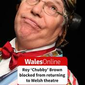
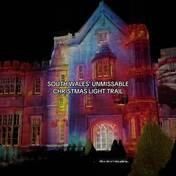
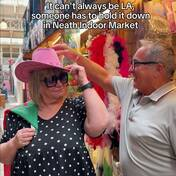
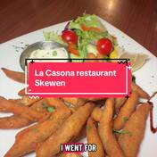

# Trend Discovery Brief — Events, places & activities, Neath Port Talbot

**Pulled:** 3 November 2026 · **Source:** ScrapeCreators API · **Window:** mostly last 12 weeks, some older high-signal posts kept
**Area in scope:** Neath, Port Talbot, Pontardawe, Briton Ferry, Aberavon, Skewen, Glynneath, Margam, Baglan, Resolven, Cwmavon, Sandfields, Cimla, Seven Sisters, Ystalyfera

## What was actually searched

120 API calls, 1,667 raw items, **942 posts that genuinely concern Neath Port Talbot** after filtering.

| Platform | Posts kept | Notes |
|---|---|---|
| TikTok | 655 | Richest source by far. Where events get reviewed. |
| YouTube | 125 | Mostly archive/walking tours, not current events. |
| Reddit | 68 | Where opinion and complaint live. r/neath, r/porttalbot, r/swansea, r/Wales. |
| Facebook | 67 | Reached via Google `site:facebook.com`. Where **listings** live. |
| Threads | 27 | Almost entirely Aberavon Beach photography. |
| Instagram | 0 | `/v2/instagram/reels/search` returned zero results on all 12 queries. |

**Four of the ten platforms you asked for are not available from ScrapeCreators.** `/v1/bluesky/search`, `/v1/mastodon/search`, `/v1/snapchat/search` and `/v1/discord/search` all return HTTP 404 — the provider does not offer those endpoints, so there is no Bluesky, Mastodon, Snapchat or Discord data in this brief. Facebook has no keyword-search endpoint either; it was reached indirectly through Google.

---

## 1. Main themes

**1. Margam Country Park is the gravitational centre of the whole pull.**
Nothing else comes close. It appears as castle, country park, Halloween event, light trail, Roman villa dig, wedding venue and film location. *Scream Time* at Margam is the single most-reviewed **event** in the data, and the reviews are unanimous: *"honestly 10/10"*, *"it's my favourite event"*, *"highly recommended"*, *"I dare ya — 10/10 wouldn't recommend without a strong bladder"*. Four separate creators posted about it inside eight days in October. Its 903k-view haunted-castle video (Project Fear) is the most-watched NPT content on YouTube.

**2. Aberavon Beach is the area's emotional anchor, and it owns Threads outright.**
Of 27 Threads posts, the overwhelming majority are Aberavon — sunsets, dog walks, monochrome photography, paintings of the beach, *"Can't beat a dip at Aberavon beach"*. It won a **2026 Seaside Award**. The affection is unprompted and multi-generational: one post recalls catching *"the 151 double decker bus from Neath to Aberavon Beach"* in the summer of 1976. Facebook has at least three dedicated beach communities. This is the strongest *place* signal in the pull, distinct from Margam's strongest *event* signal.

**3. Port Talbot is in an active, public argument about its own reputation — and the steelworks closure is underneath all of it.**
The most-engaged Reddit thread about the town is titled *"Port Talbot - such a shithole"* (488 upvotes) and is **sarcastic** — it's a photo set of the hills above the town. The comments are the whole theme in miniature: *"The actual town is grim, smells like ass and McDonald's… but lots of stunning places on the outskirts"*; *"Lived there can confirm… that's why we call it port toilet"*; *"I work in the Steelworks, it is a shit hole. I got a friend who lives in Tollgate, he loves it."* Tata recurs as the shadow over every forward-looking comment: *"With Tata closing I don't see this getting any better"*, and *"83 cafes and takeaways in port talbot… wonder how many will survive with the closure of the mill?"*

**4. Neath's food scene is the most crowded, most generous conversation in the data — and it runs on Chinese takeaways.**
A single mid-tier TikTok asking for the best Chinese in Neath produced a complete local canon in its comments, with real names and real locations: *"Chopsticks in Neath! Got to be the best"* (41 likes), *"Jade garden port talbot is a good one to try"*, *"Tonna Chinese is the best by far… best salt and pepper chips ever"*, *"Fortune house in Skewen… it was stunning"*, *"shun da in pencaerau/melin is the best in neath by far"*. Breakfast and cafés are the second front: The Front (Aberavon), Seletions (PT town centre), Belly Busters (Milland Road), Cadno Lounge, Number 46, Tambini's Express Cafe (Margam).

**5. Markets are a genuine, underrated draw — and Resolven is the one people travel for.**
Resolven Market gets repeat, high-view coverage across years and creators (217k views in 2025, 94k and 38k in 2026). It is **Saturdays only** and that is the single most common complaint about it: *"it should sooo be open on Sundays. I'd be there every week, I work most Saturdays so never get a chance"*. Neath Indoor Market and Neath Fair both have current content, including the council's own town-centre account posting about the market.

**6. Venue programming is contested, and the Plaza row is the live one.**
Roy 'Chubby' Brown being turned away from Port Talbot's revamped theatre drew 215 comments on one WalesOnline TikTok, and sentiment ran heavily against the decision: *"This country needs to get a grip"* (164 likes), *"Not my cup of tea but jesus christ if people want to watch him then why shouldn't they be allowed?"* (115), *"diverse… but not diversity of opinion"* (63). A minority pushed back on quality rather than principle: *"His latest performances have been lame… he hasn't moved with the times"*. Worth knowing before the dashboard surfaces anything Plaza-related.

**7. Pontardawe Arts Centre is the most actively programmed venue in the area.**
It posts constantly and recently: half-term programme, *Ghosts: The Possession of Button House*, Dickens' *The Chimes*, *Wildwood*, and the **first birthday of its 74-seat cinema**. It also had a facilities upgrade. For a what's-on dashboard this is the single highest-yield venue feed in NPT.

**8. The actual event listings live in Facebook groups, not on websites.**
This matters more than any theme for your purpose. The pull surfaced a dense layer of listing groups: *Gig Guide for Neath and Port Talbot*, *PUB GIGS & ENTERTAINMENTS NEATH PORT TALBOT*, *What's On In Neath And Port Talbot*, *What's on Neath / Port Talbot*, *Port Talbot Music Scene*, *Need To Know Neath Port Talbot*, *Neath Town Talk*. One is already posting full weekend line-ups (*"LIVE MUSIC FRI, SAT & SUN THIS WEEK — FRIDAY 8PM The Cover Lovers Acoustic Duo, SATURDAY 8PM The Reflex, SUNDAY 6.30PM Dewi…"*).

**9. Waterfalls and country parks are the reliable background hum.**
Gnoll Country Park, Melincourt, Henrhyd/Henryd falls near Pontardawe (196 upvotes), Cwm Du Glen, Afan Forest, Spring Valley Lakes (which *"offers scuba diving too"*, 126k views). The council also launched *"6 new adventures around Neath Port Talbot"* in October 2026.

**10. The single biggest NPT-tagged account is a barber, not a venue.**
`@samsharpbarbers` in Pontardawe has one video at **26.9 million views** (665k likes, 59.6k comments) and several more above a million. It is not event content, but it is by far the largest reach any NPT-tagged account has, and it tags Neath, Ystalyfera and Swansea. Flagging it so it doesn't distort any "top posts by views" ranking you build.

---

## 2. Best-liked places

Ranked by independent, positive, first-person mentions across platforms.

| Place | Town | Kind | Why people rate it |
|---|---|---|---|
| **Margam Country Park & Castle** | Margam | Country park / events | The area's #1. Free to enter 800 acres (charges apply for parking and special events). *"One of the prettiest castles in Wales"*. Hosts Scream Time and the Christmas light trail. 66k Facebook followers. |
| **Aberavon Beach & Seafront** | Port Talbot | Beach | 2026 Seaside Award. 3-mile sand, *"£2 to park all day"*, *"the sand is lovely and the water was clean"*. Dominates Threads. *"A tremendously practical beach (big, accessible, parking, toilets, cafes, restaurants)"*. |
| **Pontardawe Arts Centre** | Pontardawe | Theatre / cinema | Live music, drama, comedy, children's events, and a 74-seat cinema now a year old. The most consistently programmed venue in NPT. |
| **Resolven Market** | Resolven | Market / car boot | *"If you're looking for a bargain — try this market!"* Repeat viral coverage. Saturdays only. |
| **Gnoll Country Park** | Neath | Country park | *"Neath has a stunning park called gnoll park. It's gorgeous with parks, lake and…"* The default answer to "free things to do". |
| **The Arch Bar & Nightclub** | Neath | Nightlife / gigs | The area's gig venue of record on Reddit — *"The arch is in neath, so if the gig is the aim, I would stay there"*. 360k-view TikTok night out. 10 min walk from Neath station. |
| **Chopsticks / Tonna Chinese / Shun Da** | Neath | Takeaway | The clearest food consensus in the pull. *"Chopsticks in Neath! Got to be the best"*; *"Tonna… best salt and pepper chips ever"*. |
| **Cwm Du Glen & The Plantation** | Pontardawe | Walk / waterfalls | *"A fab place, you can lose yourself in amongst the waterfalls"*; redwood trees as the local surprise. Pay-and-display at the Bypass car park. |
| **Pentwyn Petting Farm** | Skewen | Family attraction | October indoor pumpkin patch, *"a great family day"*. |
| **Memo Cafe** | Aberavon Beach | Café | Top Threads post of the pull by engagement (472 likes). |
| **The Front / Seletions / Cadno Lounge / No. 46** | Aberavon, PT, Neath | Breakfast & café | The named answers in every breakfast thread. |
| **Spring Valley Lakes** | Neath | Outdoor activity | *"I can't actually believe that this place offers scuba diving too"* — 126k views, and people asked how to book. |
| **La Casona** | Skewen | Restaurant | Current date-night recommendation, *"certainly did surprise us"* (1 Nov 2026). |
| **Leicester House** | Glynneath | Café | *"A new little gem that feels like so much more than just a café"*. Also the custard-slice tour stop. |

---

## 3. Complaints

**Town-centre decline, in both towns.** The most persistent negative, and it comes from residents not visitors. *"Neath town centre has taken a nosedive in the last ten years but then so have most town centres."* A Facebook thread is titled outright *"Neath town centre in a sad state of disrepair"*. On Briton Ferry: *"some lovely views up here, not a lot of open shops though"* — whose top comment was *"Thank the Welsh government ripping us off same in Port Talbot."*

**Margam Park parking charges.** The one complaint attached to the area's best-loved place. *"The all day price feels excessive at that time of day"*, and a whole Reddit thread of locals explaining how to park outside and walk in. Note the counter-voice: *"What you shouldn't do is park in the Margam car park and lie about parking to staff at the gate."*

**Visible drink and drug problems, Port Talbot especially.** A photo of Morrisons Port Talbot locking down its alcohol aisle drew 133 upvotes and 50 comments: *"How to tell people in PT have an alcohol problem without telling them they have an alcohol problem"*; *"Hoho, that's a sad indictment of the town."* A Neath Tesco worker: *"alcohol theft is a regular occurrence… police don't show up, they've not got the man power."* And a resident on Port Talbot: *"I won't even go to town or station road anymore after lunchtime because it just isn't safe."*

**The Plaza / Chubby Brown booking refusal.** Running at roughly 4:1 against the venue's decision in the comments. A real reputational flashpoint for a newly revamped venue.

**Steelworks: smell, air quality, and now job losses.** *"Camera's can't smell the Steelworks."* Port Talbot's historic *"most polluted area of the UK"* billing still circulates. The newer anxiety is economic, not environmental.

**Aberavon Beach safety and sand drift.** A man died after entering the water in the June 2026 heatwave. Separately the council posted that *"due to recent high winds, Aberavon Seafront is experiencing a high volume of sand"* — a current, practical condition worth surfacing on a dashboard.

**Resolven Market: Saturdays only, and expectation management.** *"It's like a jumble sale in there"*; *"It's not what it was hyped up to be. I was so disappointed when I went."* Against many who love it — so present it as a car-boot, not a boutique market.

**Specific areas flagged by residents.** Melin, Briton Ferry and Fairyland named as places to avoid when house-hunting; Cimla, Skewen, Bryncoch, Cadoxton and Caewern named as the good ones. Also one serious thread on racism in Neath, and an August 2026 report of a man urinating on the Neath mosque door and threatening to burn it down.

**Hotel capacity.** A recurring practical gap: *"There aren't too many hotels in Neath (no premier inns/travelodge etc)"*. Castle Hotel and Bluebell Hotel are the two named, both minutes from The Arch.

---

## 4. Notable posts

Thumbnails are saved locally at the paths shown, 176×176 JPEG.

| | Post | Platform | Engagement | Why it matters |
|---|---|---|---|---|
|  | [Scream time at Margam park honestly 10/10!](https://www.tiktok.com/@charlyannec/video/7698471118021152003) — @charlyannec, 19 Oct 2026 | TikTok | 108,964 views · 7,421 likes | The best-reviewed event in the entire pull. |
|  | [Chubby Brown turned away from Port Talbot's revamped theatre](https://www.tiktok.com/@walesonline/video/7702182700068769057) — @walesonline, 29 Oct 2026 | TikTok | 55,159 views · 215 comments | The live local controversy. Highest comment-to-view ratio in the pull. |
|  | [visiting the local pub/nightclub 😭🍸 @The Arch Bar & Nightclub](https://www.tiktok.com/@emilywoodfin/video/7672067033713986838) — @emilywoodfin, 9 Aug 2026 | TikTok | 360,695 views · 22,683 likes | Biggest reach of any NPT *venue* post. Establishes The Arch as the nightlife landmark. |
|  | [Haunted Margam Castle: Something Went Wrong](https://www.youtube.com/watch?v=a2Lo-GfYeL0) — PROJECT FEAR | YouTube | 903,435 views | Most-watched NPT content anywhere. Drives the Margam ghost-tourism cycle. |
|  | [South Wales' best light trail has returned to Margam Park — 6,000 illuminated roses](https://www.tiktok.com/@cardifflovelist/video/7574009409026690326) — @cardifflovelist, 18 Nov 2025 | TikTok | 371,371 views · 21,842 likes | Last year's Christmas trail. Expect the 2026 edition imminently — worth watching for the dashboards. |
|  | [I visited Resolven Market… is this the best car boot in South Wales?](https://www.tiktok.com/@christopherlevans/video/7677558340578315542) — @christopherlevans, 24 Aug 2026 | TikTok | 38,197 views · 1,549 likes | The market that pulls people in from outside the county. |
|  | [Neath Fair/Market 2026](https://www.tiktok.com/@kelsey.mw/video/7683876586310978819) — @kelsey.mw, 10 Sep 2026 | TikTok | 10,035 views | First-person account of this year's fair — *"so many different traders… a massive amount of rides"*. |
|  | [Let's go do the RICHARD BURTON 10k run](https://www.tiktok.com/@liamevansx/video/7703269213628009750) — @liamevansx, 1 Nov 2026 | TikTok | 11,565 views | The area's signature annual race, posted two days ago. A recurring calendar fixture. |
|  | [The celeb of Neath Indoor Market has arrived](https://www.tiktok.com/@npttowncentres/video/7684249207858810134) — @npttowncentres, 11 Sep 2026 | TikTok | 12,024 views | The council's own town-centre account. Bilingual, and a ready-made official feed. |
|  | [La Casona, Skewen — date night](https://www.tiktok.com/@fearnstar/video/7703126735923006752) — @fearnstar, 1 Nov 2026 | TikTok | 11,169 views | Freshest venue recommendation in the pull. @fearnstar is the most prolific NPT places creator. |
|  | [A spooky trail at a real life haunted house in Wales](https://www.tiktok.com/@indigojonesjournalist/video/7697191904374557974) — @indigojonesjournalist, 16 Oct 2026 | TikTok | 62,234 views | Second independent Scream Time review in the same week — confirms it, rather than repeating it. |
|  | [Discover the heart of Neath Port Talbot](https://www.youtube.com/watch?v=5DfMOcYnVfE) — Neath Port Talbot Council | YouTube | 253,341 views | The council's own place-marketing film, and its reach is real. |

**Top Reddit posts, no thumbnails available from the API:**

- [Margam Castle, Neath Port Talbot, Wales 🏴󠁧󠁢󠁷󠁬󠁳󠁿 🏰](https://www.reddit.com/r/castles/comments/1swcgba/margam_castle_neath_port_talbot_wales/) — r/castles, 744 upvotes, Apr 2026. Margam's reach well beyond Wales.
- [Port Talbot - such a shithole.](https://www.reddit.com/r/Wales/comments/upkisq/port_talbot_such_a_shithole/) — r/Wales, 488 upvotes, 75 comments. Sarcastic; the definitive reputation thread.
- [Henryd falls near Pontardawe has an astonishingly beautiful 90 foot drop](https://www.reddit.com/r/Wales/comments/o2xyy8/henryd_falls_near_pontardawe_has_an_astonishingly/) — r/Wales, 196 upvotes.
- [Morrisons, Port Talbot](https://www.reddit.com/r/Wales/comments/1gjc14m/morrisons_port_talbot/) — r/Wales, 133 upvotes, 50 comments. The alcohol-lockdown thread.
- [Neath Model Railway Show](https://www.reddit.com/r/CasualUK/comments/1sjb4kk/neath_model_railway_show/) — r/CasualUK, Apr 2026. A small recurring event with national reach.

---

## 5. Using this as a dashboard datasource

What the data actually supports, for the three NPT artifacts:

**Highest-yield feeds to poll** — ranked by listings density, not popularity:

1. **Pontardawe Arts Centre** Facebook page — the only venue in NPT publishing a full forward programme socially.
2. **Facebook listing groups** — *Gig Guide for Neath and Port Talbot* (`groups/1719701018281009`), *PUB GIGS & ENTERTAINMENTS NPT* (`groups/196453747792207`), *What's On In Neath And Port Talbot* (`groups/121676847869402`), *What's on Neath / Port Talbot* (`groups/1547730155456541`), *Port Talbot Music Scene* (`groups/1048348985663965`).
3. **Margam Country Park** page (66k followers) — events, closures, light trail, Scream Time.
4. **@npttowncentres** TikTok and **Neath Port Talbot Council** Facebook — official, bilingual, and already event-shaped.
5. **Aberavon Beach** community pages — conditions and closures as much as events.

**Three cautions before this is wired in:**

- `fetch_posts.py` in `dashboards-source/plymouth/social-signals/` already fetches Facebook and Instagram **account feeds**, which is the right mechanism for the listing groups above. This pull used keyword search instead, which finds *talk about* places rather than listings. Both are needed, and they are different jobs.
- The place-name filter matters more here than it did for Plymouth. "Neath" collides with the Welsh-English contraction of *beneath* and with a Fallen London location; "Seven Sisters" pulls far more content about the Sussex cliffs than the NPT village; "Baglan" pulls Kazakh-language memes. `flatten.py` handles the first case and the brief's analysis excluded the rest by hand — any scheduled version needs those exclusions encoded, not reapplied by judgement.
- Instagram returned nothing at all. Before concluding NPT has no Instagram presence, try `/v2/instagram/user/posts` against named venue handles, as Plymouth does.

---

## Files

All under `npt-social/` in this repository:

- `trend-brief-2026-11-03.md` — this brief
- `pull.py` — the keyword pull (120 calls across 6 platforms)
- `flatten.py` — normalises and relevance-filters into `posts.json`
- `comments.py` — pulls comment threads for named posts
- `posts.json` — 942 filtered posts
- `comments.json` — 172 comments across 15 threads
- `notable.json` — the posts in section 4, with local thumbnail paths
- `thumbs/` — 12 thumbnails, 176×176 JPEG

The API key was read from `$SCRAPECREATORS_API_KEY` in the environment and is not printed, logged or stored in any of these files.
